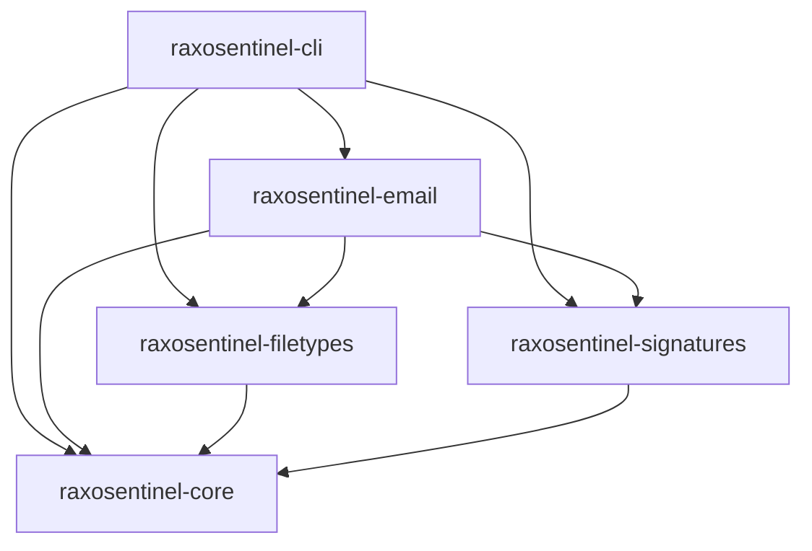
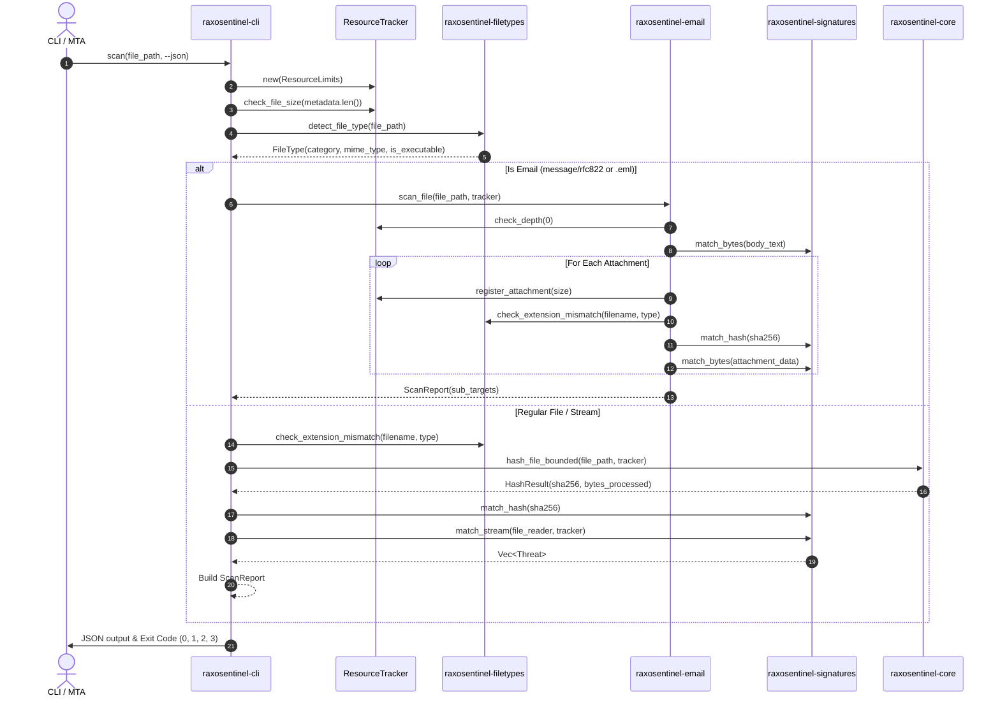

# RaxoSentinel Architecture Document

## Overview

RaxoSentinel Core is an independent, native Rust malware-detection engine engineered for high-throughput email security pipelines. Unlike legacy antivirus software designed around long-running background daemons, monolithic signature blobs, or unbounded memory buffers, RaxoSentinel is designed as a modular, embeddable set of Rust crates with deterministic resource constraints.

---

## Architectural Principles

1. **Zero Uncontrolled Memory Allocation**:
   Memory usage is strictly bounded. File reading, SHA-256 calculation, and multi-pattern scanning execute in chunked streaming buffers (default: 64 KiB). Processing a 500 MiB file consumes no more heap memory than scanning a 10 KiB file.
2. **Defensive Processing of Untrusted Input**:
   Every input stream (headers, boundaries, encoded parts) is treated as potentially adversarial. Recursion depth, attachment counts, and cumulative extracted sizes are actively tracked and bounded by `ResourceTracker`.
3. **Absence of Detection $\neq$ Universal Safety**:
   The engine makes a rigorous semantic distinction between finding no threats (`CLEAN`) and guaranteeing safety. Reports contain explicit notices that clean results reflect current signature coverage, not absolute safety.
4. **No External Runtime Dependencies**:
   Pure Rust implementation with zero dependencies on ClamAV daemons, C libraries with memory-safety risks, databases (PostgreSQL/Redis), message brokers (NATS/Kafka), or cloud APIs.

---

## Workspace Layout & Crate Hierarchy

### 1. `raxosentinel-core`
The foundational crate defining scanning contracts, resource budgeting, and reporting primitives:
- **`ResourceLimits` & `ResourceTracker`**: Tracks dynamic bytes read, wall-clock scan timeout, nesting depth, attachment counts, and cumulative decompressed bytes.
- **`hash`**: Streaming SHA-256 implementation (`hash_reader_bounded`, `hash_file_bounded`) operating over arbitrary `std::io::Read` instances using bounded buffers.
- **`threat`**: `Threat`, `ThreatCategory`, and `Severity` enums providing strongly typed anomaly classifications.
- **`status`**: `ScanStatus` enum (`Clean`, `Infected`, `Unsupported`, `Failed`) with corresponding CLI exit codes (0, 1, 2, 3).
- **`report`**: `ScanReport` and `TargetMetadata` enabling structured, JSON-serializable reporting with sub-target trees for email attachments.
- **`memory`**: Linux `/proc/self/status` resident set size (RSS) and peak RSS (VmHWM) telemetry collector.

### 2. `raxosentinel-filetypes`
Content-based file identification looking exclusively at actual bytes rather than untrusted filename extensions:
- **Magic Byte Inspection**: Detects Windows PE, DOS, ELF, Mach-O, Java `.class`, WebAssembly, PDF, RTF, OLE Compound Documents, Office OpenXML, ZIP, GZIP, BZIP2, 7z, RAR (4.x/5.x), TAR, XZ, images (PNG, JPEG, GIF, BMP, WebP), scripts (Shell, Python, Batch, PowerShell, HTML/XML), and RFC 822 email messages.
- **Extension Mismatch Engine**: Detects dangerous disguised binaries (e.g. `invoice.pdf` or `photo.jpg` having an executable PE header) and deceptive double extensions (`invoice.pdf.exe`).

### 3. `raxosentinel-signatures`
The signature compilation and matching engine:
- **Exact SHA-256 Table**: Fast `HashMap<String, HashRule>` lookup for known threat digests.
- **Aho-Corasick Multi-Pattern Automaton**: Compiles arbitrary byte patterns into an automaton for single-pass multi-pattern matching.
- **Sliding Window Stream Matcher**: Implements chunked streaming (`match_stream`) with a carry-over buffer equal to `max_pattern_len - 1` bytes across chunk boundaries. This guarantees that patterns spanning boundary seams (e.g. split across consecutive 64 KiB reads) are always detected.
- **External Rule Loader**: JSON-based rule loader (`load_rules_from_file`, `load_rules_from_str`) for loading custom signature packs with schema validation.

### 4. `raxosentinel-email`
Specialized email security parser:
- **Zero-Copy MIME Parsing**: Uses `mail-parser` to parse RFC 5322 / RFC 2045 messages without panicking on malformed inputs.
- **Recursive Container Scanning**: Automatically extracts multipart attachments, decodes transfer encodings (Base64, Quoted-Printable), and recurses into nested `message/rfc822` emails up to the configured depth limit.
- **Body & Header Security Analysis**: Scans plain text and HTML bodies for embedded payload signatures (e.g. encoded PowerShell strings, Certutil invocation patterns, EICAR test strings).
- **Privacy Preservation**: Never logs or serializes raw email bodies or attachment contents into system logs.

### 5. `raxosentinel-cli`
The standalone command-line driver:
- Binary name: `raxosentinel`.
- Invocation: `raxosentinel scan <FILE_PATH> [--json] [--memory] [--rules <PATH>] [--max-size <BYTES>] [--timeout <SECS>]`.
- Automatically routes emails to `EmailScanner` and raw files to stream hashing and signature matching.
- Returns strict status exit codes for automated integration into MTA milters, CI/CD pipelines, or shell scripts.

---

## End-to-End Scan Pipeline

---

## Memory Bounding Strategy

To guarantee predictable memory consumption in high-volume email gateways:
- All disk reads operate through a `BufReader` with a fixed buffer size (default 64 KiB).
- Hashes are updated incrementally (`Sha256::update`).
- Pattern matching over streams maintains only an overlap slice between chunks (`max_pattern_len - 1`).
- MIME attachments are checked against individual size (`max_email_attachment_size`) and cumulative extraction quotas (`max_total_extracted_bytes`) before allocating memory.
- Measured peak RSS on real workloads remains constant at **~3.5 MiB**.
