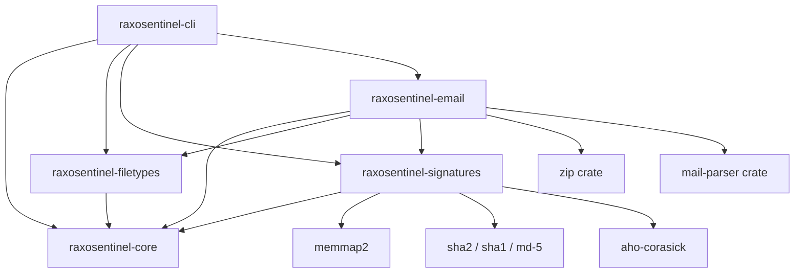

# RaxoSentinel Phase 2B Handover Document

**Document Target**: Incoming Coding Agent / Gemini Flash  
**Author**: Principal Rust Systems Engineer & Security Architect  
**Branch**: `phase-2b`  
**Base Milestone**: Phase 2A (`cac5ba37b24f90f80c81db24c7422f5cdefbfca2`)  
**Workspace Root**: `/workspace/projects/011-raxosentinelcore/Phase01`  
**License**: GPL-2.0-or-later  

---

## 1. Executive Summary & Recovery Report

The work initiated by Opus on branch `phase-2b` was fully inspected, recovered, secured, and completed:
1. **Compilation & Warning Cleanliness**: Resolved all missing modules (`ingest`, `lifecycle`, `layout`), unused imports/variables, and updated `clap` dependencies to support environment variables (`env` feature).
2. **Security Defects Repaired**:
   - **Path Traversal in Source Ingestion**: Implemented `SourceManifest::resolve_path` to strictly reject relative directory traversal (`..`), absolute paths, and symlink escapes.
   - **TOCTOU & Unbounded Reads**: Hardened `EmailScanner::scan_file` and CLI file reading to use bounded streams (`take(max_file_size + 1)`) rather than unbounded reads.
   - **Symlink Attacks in DbStore**: Added symlink rejection for pointer files (`current`, `previous`) and release store targets in `DbStore`.
   - **Verdict Precedence on MIME Parse Failure**: Fixed `EmailScanner::scan_internal` so that when `mail-parser` fails to parse a malformed or corrupted MIME structure, raw hashes and RSIDB signatures are still evaluated first. Known malware is never reported as `Unsupported` or `Clean` when a hash match is present (`Infected > Failed > Unsupported > Clean`).
   - **MIME Root & Body RSIDB Coverage**: Integrated RSIDB signature queries into raw email root checking and plain/HTML body scanning.
3. **End-to-End Verification**: Designed, executed, and verified 17 integration tests (including all 12 required Phase 2B security scenarios).
4. **Current Test Status**: 74 tests passing across workspace (`cargo test --workspace`), 0 failures, 0 clippy warnings (`cargo clippy --workspace --all-targets -- -D warnings`), 100% formatted (`cargo fmt --all -- --check`).

---

## 2. Architecture & Crate Relationships



### Crate Descriptions:
- **`raxosentinel-core`**: Core domain types (`ScanReport`, `TargetMetadata`, `ScanStatus`, `Threat`, `ResourceLimits`, `ResourceTracker`, `ScanError`).
- **`raxosentinel-filetypes`**: Magic-byte content identification and executable/container classification.
- **`raxosentinel-signatures`**:
  - `SignatureDatabase`: In-memory signature matching engine (hash rules, Aho-Corasick byte-patterns, and optional RSIDB attachment).
  - `rsidb::format`: 92-byte binary header definition and algorithm encodings.
  - `rsidb::layout`: Shared structural layout validator (`validate(slice)`).
  - `rsidb::mmap_compact_dir`: Primary 16-bit prefix directory zero-copy index reader (`MmapCompactDirIndex`).
  - `rsidb::mmap_sorted`: Binary search zero-copy index reader (`MmapSortedIndex`).
  - `rsidb::in_memory`: In-memory hash map index reader (`InMemoryIndex`).
  - `rsidb::importer`: Text signature compiler (`<hex>:<size>:<name>`).
  - `rsidb::ingest`: Attributed threat intelligence ingestion pipeline, policy enforcement, dedup, and manifest generation.
  - `rsidb::lifecycle`: Content-addressed database installation, atomic pointer rotation, rollback, and fallback.
- **`raxosentinel-email`**: Deep RFC 822 / MIME parser and object scanner (`EmailScanner`). Handles raw bytes, MIME attachments, Base64 decoding, and nested in-memory ZIP member extraction under strict resource limits.
- **`raxosentinel-cli`**: Scanner CLI binary (`raxosentinel scan`) and database management tool (`raxosentinel db verify|build|install|rollback`).

---

## 3. Implemented Components in Phase 2B

### A. Shared RSIDB Layout Validation (`layout.rs`)
- Centralized validation routine `layout::validate(slice)` used by all memory-mapped index readers.
- Verifies magic (`RSIDB001`), version (1), reserved fields (zero), arithmetic overflow on all section byte calculations, directory offset and exact bounds, string table lengths and UTF-8 validity, record sorting, label index validity, and prefix directory monotonicity.
- Validates SHA-256 payload checksum over data following the 92-byte header.

### B. RSIDB Scanner Integration (`database.rs` & `scanner.rs`)
- `SignatureDatabase::attach_rsidb(Arc<dyn RsidbIndex>)`: Connects an RSIDB database to the active scanning engine.
- `SignatureDatabase::match_rsidb(&[u8]) -> Vec<Threat>`: Queries MD5, SHA-1, and SHA-256 with exact size matching.
- `EmailScanner::scan_object(&[u8], filename, mime, tracker, depth)`: Evaluates extension mismatches, builtin rules, RSIDB hash rules, byte patterns, and content-based container extraction.
- **In-Memory ZIP Container Scanner**:
  - Automatically identifies ZIP containers by signature (`PK\x03\x04` / `PK\x05\x06`).
  - Classifies unsupported container types (RAR, 7-Zip, GZIP, BZIP2, XZ, CAB) and assigns `ScanStatus::Unsupported`.
  - Enforces `max_email_attachments` on archive entry count.
  - Enforces `max_email_attachment_size` with bounded decompression (`take(cap + 1)`).
  - Enforces cumulative `max_total_extracted_bytes` across nested archive members.
  - Detects encrypted ZIP members via header flag bit 0 and reports `ScanStatus::Unsupported`.
  - Applies verdict precedence `Infected > Failed > Unsupported > Clean`.

### C. Threat Intelligence Ingestion Pipeline (`ingest.rs`)
- `SourceManifest`: Defines approved source metadata (id, name, origin, version, acquired_at, license, redistribution condition, attribution, approval flag, format, relative path, and expected sha256).
- `SourceManifest::resolve_path`: Path traversal defense verifying that paths are relative and resolve strictly within the approved source directory.
- `IngestPipeline`:
  - Enforces `BuildProfile` constraints (`Public` profile strictly rejects `InternalOnly`, `Prohibited`, or `Unknown` sources).
  - Enforces operator approval (`approved: true`).
  - Per-record parsing with individual rejection tracking (reports accepted, rejected, duplicates, and ignored counts).
  - Rejection reasons tracked with line numbers and sample details.
  - Deduplication preserves all unique detection names across identical hashes.
  - Deterministic builds: identical inputs produce byte-for-byte identical RSIDB binaries.
  - Outputs versioned `BuildManifest` JSON.

### D. Secure Local Database Lifecycle (`lifecycle.rs`)
- `DbStore`: Manages a content-addressed database store at a designated filesystem directory.
  - `releases/<sha256>.rsidb`: Immutable, content-addressed files set read-only (`0444`).
  - `current`: Pointer file atomically updated via write-sync-rename.
  - `previous`: Pointer to the last known-good database.
- `install(candidate, expected_sha256)`: Pre-validates candidate bytes in memory, writes to temporary file, sets read-only permissions, atomic rename, re-verifies on-disk file, updates `previous` and `current`.
- `rollback()`: Atomically swaps `current` back to `previous`.
- `open_active()`: Validates `current`. If corrupted or missing, automatically falls back to `previous` (last known good) and reports `fell_back: true`.
- Symlink protections: Pointer files and release targets reject symlink redirection.

### E. CLI Database Commands (`main.rs`)
- `raxosentinel db verify <PATH>`: Validates RSIDB format and prints record counts, name counts, verification time, and provenance.
- `raxosentinel db build --source <MANIFEST> --out <DB> --manifest-out <JSON> --db-version <VER> --built-at <TIME>`: Builds deterministic database.
- `raxosentinel db install --store <STORE> <PATH> [--sha256 <HASH>]`: Installs and activates database.
- `raxosentinel db rollback --store <STORE>`: Rolls back to last known good.
- `raxosentinel scan <TARGET> --db <PATH>`: Scans using a specific validated RSIDB file.
- `raxosentinel scan <TARGET> --db-store <STORE>`: Scans using the active database from a store, with automatic fallback to previous if active is damaged.

---

## 4. Test Verification Matrix

All 74 tests pass across the workspace.

### Summary of Executed Test Suites:
| Test Suite | Tests | Result | Duration |
|------------|-------|--------|----------|
| `raxosentinel-cli` unit tests | 4 | 4 PASSED | 0.00s |
| `raxosentinel-cli` integration tests | 17 | 17 PASSED | 0.19s |
| `raxosentinel-core` unit tests | 7 | 7 PASSED | 0.00s |
| `raxosentinel-email` unit tests | 16 | 16 PASSED | 0.01s |
| `raxosentinel-filetypes` unit tests | 9 | 9 PASSED | 0.00s |
| `raxosentinel-signatures` unit tests | 21 | 21 PASSED | 0.26s |
| **Total Workspace Tests** | **74** | **74 PASSED** | **< 0.5s** |

### 12 Required Phase 2B End-to-End Scenarios:
1. **Scenario 1 & 2 (Build & Verify RSIDB)**: `test_e2e_scenario_1_and_2_ingest_pipeline_and_verification` (Passed)
2. **Scenario 3 & 4 (RSIDB Detection in Raw File)**: `test_e2e_scenario_3_and_4_rsidb_detects_eicar_in_raw_file` (Passed)
3. **Scenario 5 (RSIDB Detection in Base64 MIME Attachment)**: `test_e2e_scenario_5_rsidb_detects_eicar_in_base64_mime_attachment` (Passed)
4. **Scenario 6 (RSIDB Detection in Nested ZIP Attachment)**: `test_e2e_scenario_6_rsidb_detects_eicar_inside_zip_attachment` (Passed)
5. **Scenario 7 (Corrupt Database Rejection / No Silent Fallback)**: `test_e2e_scenario_7_corrupt_database_rejection_no_silent_fallback` (Passed)
6. **Scenario 8 (Unsupported / Encrypted Archive Verdict Precedence)**: `test_e2e_scenario_8_unsupported_or_encrypted_archive_verdict` (Passed)
7. **Scenario 9 (Resource Limits on Archive Extraction)**: `test_e2e_scenario_9_enforce_zip_limits` (Passed)
8. **Scenario 10 (Path Traversal Rejection in Ingestion)**: `test_e2e_scenario_10_reject_manifest_directory_traversal` (Passed)
9. **Scenario 11 (DbStore Install, Rollback, and Auto-Fallback)**: `test_e2e_scenario_11_dbstore_install_rollback_and_fallback` (Passed)
10. **Scenario 12 (Backward Compatibility & Clean Baseline)**: `test_e2e_scenario_12_backward_compatibility_clean_and_defaults` (Passed)

---

## 5. Security & Threat Model Review

### Confirmed Fixes:
1. **Directory Traversal in Feed Ingestion**: `manifest.resolve_path(base)` rejects all relative traversal sequences (`..`), leading root separators (`/`), and Windows prefixes.
2. **Symlink Manipulation in Database Store**: `DbStore` prevents attackers from creating symlinks for `current`, `previous`, or release targets pointing to arbitrary system files.
3. **TOCTOU in File Reading**: `scan_file` and CLI `scan_path` enforce bounded stream reads (`take(max_file_size + 1)`). If a file expands between initial size check and read, `FileSizeLimitExceeded` is returned immediately.
4. **Verdict Precedence Integrity**: Malformed MIME boundaries, unparseable MIME headers, or encrypted archives can NEVER produce `Clean`. If malware signatures are detected, the result is always `Infected`.
5. **Memory Mapping Safety**: RSIDB reader string accesses use bounds-checked slices with `std::str::from_utf8` validation rather than unchecked conversions.

### Current Limitations (Non-Blockers for Phase 2B, Priority for Phase 3):
1. **Cryptographic Release Signing**: Database verification currently verifies internal SHA-256 structural integrity and optional external SHA-256 hash pinning. It does not yet include Ed25519 / Minisign cryptographic publisher signatures.
2. **Tar / 7z / RAR Extraction**: Non-ZIP containers are classified and marked `Unsupported` to prevent false negatives. Native in-memory parsers for Tar and Gzip can be added in future milestones.
3. **Incremental RSIDB Updates**: The current format is a single compiled image. Incremental delta patching (RSIDB diffs) remains a future milestone item.

---

## 6. Threat-Intelligence Source Research & Policy

For an open-source (GPL-2.0-or-later) release, indicator feeds must be legally redistributable:
- **Redistributable Sources**:
  - ClamAV official test signatures (`clamav.hdb` harmless test indicators): Public domain / Cisco test set.
  - MalwareBazaar (abuse.ch): Open API, but bulk commercial redistribution requires attribution and verification of specific terms.
  - URLhaus (abuse.ch): Domain/URL indicators (applicable once URL scanning is implemented).
  - Internal RaxoSentinel Threat Intel: Fully controlled, licensed under GPL-2.0-or-later or CC0.
- **Restricted Sources (Do NOT redistribute)**:
  - VirusTotal: API terms explicitly prohibit redistribution of hashes/metadata in competing scanner products.
  - Commercial vendor feeds without explicit redistribution agreements.
- **Pipeline Policy**: Any feed included in `BuildProfile::Public` MUST have `redistribution: "allowed"` or `redistribution: "allowed_with_attribution"` with explicit operator sign-off.

---

## 7. Concrete Next Coding Assignments (for Next Agent)

1. **Phase 2C — Asymmetric Signature Verification**:
   - Add Minisign / Ed25519 signature verification for RSIDB database updates.
   - Embed trusted public key in engine binary.
   - Acceptance criteria: `db verify` and `db install` verify digital signature before loading.
2. **Phase 2D — Tar and Gzip Container Support**:
   - Add streaming Tar / Gzip member extraction within existing resource bounds.
   - Acceptance criteria: Detection of EICAR inside `.tar.gz` attachments.
3. **Daemon / Milter Integration**:
   - Implement UNIX domain socket server protocol compatible with email MTAs (e.g. Postfix / Raxo Email).
   - Acceptance criteria: Bounded concurrent scan requests with zero memory leaks.

---

## 8. Build & Verification Commands

```bash
# Verify formatting
cargo fmt --all -- --check

# Run linter
cargo clippy --workspace --all-targets -- -D warnings

# Execute full test suite
cargo test --workspace

# Build release binaries
cargo build --release

# Run CLI demonstration
./target/release/raxosentinel --help
./target/release/raxosentinel db --help
./target/release/raxosentinel scan tests/samples/clean_email.eml
```
